# Modelo entidade-relacionamento físico da clínica

Representa as **26 tabelas implementadas** no PostgreSQL, até a revisão Alembic
`0010_monthly_agenda_schema`. Os nomes e as relações vêm dos modelos ORM;
colunas completas, índices e constraints estão no [dicionário físico](../database/schema.md).
Os [diagramas conceituais](clinic-database-diagrams.md) explicam os fluxos do produto.

Fonte Mermaid independente: [clinic-database-er.mmd](clinic-database-er.mmd).

## Leitura do modelo

- `PK`: chave primária; `FK`: coluna de chave estrangeira. As colunas marcadas
  como PK em uma associação formam **uma única chave composta**.
- `||`: exatamente um; `o|`: zero ou um; `o{`: zero ou muitos.
- As legendas das ligações indicam as colunas locais, omitindo `tenant_id`.
  As FKs clínicas incluem esse campo e impedem referências entre organizações.
- Para reduzir cruzamentos, ligações diretas de `tenant_id` são mostradas nas
  raízes do catálogo e em `user_tenant`; as demais continuam marcadas como FK.
- Referências redundantes entre o mesmo par de tabelas são representadas pela
  FK mais completa. Timestamps comuns foram omitidos para facilitar a leitura.
- Os tipos são físicos: UUID, TIMESTAMPTZ, DATE, TIME, TEXT, INTEGER, BOOLEAN e
  JSONB. `weekday` usa SMALLINT no banco, agrupado como integer nesta visão.

As cardinalidades representam a integridade do schema, não a execução de
serviços clínicos. Estados, condições de agendamento e transições de reposição
continuam sujeitos às regras [RN-001 a RN-026](../business/business-rules.md).

## Visão completa

```mermaid
erDiagram
    direction TB
    tenant {
        uuid id PK
        text name
        boolean active
    }
    user {
        uuid id PK
        text name
        boolean active
    }
    user_tenant {
        uuid tenant_id PK, FK
        uuid user_id PK, FK
        text role
        boolean active
    }
    clinic {
        text name
        text timezone
        integer default_duration_minutes
        boolean active
        uuid id PK
        uuid tenant_id FK
    }
    patient {
        text name
        boolean active
        uuid id PK
        uuid tenant_id FK
    }
    therapist {
        text name
        boolean active
        uuid id PK
        uuid tenant_id FK
    }
    specialty {
        text name
        text normalized_name
        boolean active
        uuid id PK
        uuid tenant_id FK
    }
    patient_clinic {
        uuid tenant_id PK, FK
        uuid patient_id PK, FK
        uuid clinic_id PK, FK
        boolean active
    }
    therapist_clinic {
        uuid tenant_id PK, FK
        uuid therapist_id PK, FK
        uuid clinic_id PK, FK
        boolean active
    }
    room {
        uuid clinic_id FK
        text name
        text normalized_name
        boolean active
        uuid id PK
        uuid tenant_id FK
    }
    therapist_specialty {
        uuid tenant_id PK, FK
        uuid therapist_id PK, FK
        uuid specialty_id PK, FK
        boolean active
    }
    room_specialty {
        uuid tenant_id PK, FK
        uuid room_id PK, FK
        uuid specialty_id PK, FK
        boolean active
    }
    treatment_plan {
        uuid id PK
        uuid tenant_id FK
        uuid patient_id FK
        uuid therapist_id FK
        uuid specialty_id FK
        integer sessions_per_week
        integer duration_minutes "opcional"
        date valid_from
        date valid_until "opcional"
    }
    treatment_plan_clinic {
        uuid tenant_id PK, FK
        uuid treatment_plan_id PK, FK
        uuid clinic_id PK, FK
        boolean active
    }
    patient_availability {
        uuid id PK
        uuid tenant_id FK
        uuid clinic_id FK
        uuid patient_id FK
        integer weekday
        time start_time
        time end_time
        date valid_from
        date valid_until "opcional"
    }
    therapist_availability {
        uuid id PK
        uuid tenant_id FK
        uuid clinic_id FK
        uuid therapist_id FK
        integer weekday
        time start_time
        time end_time
        date valid_from
        date valid_until "opcional"
    }
    clinic_hours {
        uuid id PK
        uuid tenant_id FK
        uuid clinic_id FK
        integer weekday
        time start_time
        time end_time
        date valid_from
        date valid_until "opcional"
    }
    weekly_slot {
        uuid id PK
        uuid tenant_id FK
        uuid treatment_plan_id FK
        uuid clinic_id FK
        uuid room_id FK
        integer weekday
        time start_time
        integer duration_minutes
        date valid_from
        date valid_until "opcional"
    }
    appointment {
        uuid id PK
        uuid tenant_id FK
        uuid treatment_plan_id FK
        uuid clinic_id FK
        uuid room_id FK
        uuid patient_id FK
        uuid therapist_id FK
        uuid specialty_id FK
        timestamptz starts_at
        timestamptz ends_at
        integer duration_minutes
        text origin
        text status
        uuid weekly_slot_id FK "opcional"
        date occurrence_date "opcional"
        boolean manually_adjusted
        text replacement_decision
        uuid replacement_due_id FK "opcional"
    }
    appointment_event {
        uuid id PK
        uuid tenant_id FK
        uuid appointment_id FK
        uuid actor_id FK "opcional"
        timestamptz recorded_at
        text kind
        jsonb before
        jsonb after
    }
    replacement_due {
        uuid id PK
        uuid tenant_id FK
        text original_origin FK "gerado: routine"
        uuid original_appointment_id FK
        uuid treatment_plan_id FK
        text reason
        text status
        uuid decided_by FK "opcional"
        timestamptz decided_at "opcional"
        text closed_reason "opcional"
    }
    clinic_closure {
        uuid id PK
        uuid tenant_id FK
        uuid clinic_id FK
        timestamptz starts_at
        timestamptz ends_at
        text reason
        uuid created_by FK
    }
    person_block {
        uuid id PK
        uuid tenant_id FK
        uuid patient_id FK "opcional"
        uuid therapist_id FK "opcional"
        timestamptz starts_at
        timestamptz ends_at
        text reason
        uuid created_by FK
    }
    monthly_agenda {
        uuid id PK
        uuid tenant_id FK
        uuid clinic_id FK
        date month
    }
    generation_run {
        uuid id PK
        uuid tenant_id FK
        uuid monthly_agenda_id FK
        timestamptz started_at
        timestamptz completed_at "opcional"
        text status
        jsonb parameters
    }
    generation_deficit {
        uuid id PK
        uuid tenant_id FK
        uuid generation_run_id FK
        uuid treatment_plan_id FK
        date week_start
        integer missing_count
        text reason_code
        jsonb details
    }
    appointment ||--o{ appointment_event : "appointment_id"
    appointment ||--o| replacement_due : "original_appointment_id, treatment_plan_id, original_origin"
    clinic ||--o{ appointment : "clinic_id"
    clinic ||--o{ clinic_closure : "clinic_id"
    clinic ||--o{ clinic_hours : "clinic_id"
    clinic ||--o{ monthly_agenda : "clinic_id"
    clinic ||--o{ patient_availability : "clinic_id"
    clinic ||--o{ patient_clinic : "clinic_id"
    clinic ||--o{ room : "clinic_id"
    clinic ||--o{ therapist_availability : "clinic_id"
    clinic ||--o{ therapist_clinic : "clinic_id"
    clinic ||--o{ treatment_plan_clinic : "clinic_id"
    clinic ||--o{ weekly_slot : "clinic_id"
    generation_run ||--o{ generation_deficit : "generation_run_id"
    monthly_agenda ||--o{ generation_run : "monthly_agenda_id"
    patient ||--o{ appointment : "patient_id"
    patient ||--o{ patient_availability : "patient_id"
    patient ||--o{ patient_clinic : "patient_id"
    patient o|--o{ person_block : "patient_id"
    patient ||--o{ treatment_plan : "patient_id"
    replacement_due o|--o{ appointment : "replacement_due_id, treatment_plan_id"
    room ||--o{ appointment : "clinic_id, room_id"
    room ||--o{ room_specialty : "room_id"
    room ||--o{ weekly_slot : "clinic_id, room_id"
    specialty ||--o{ appointment : "specialty_id"
    specialty ||--o{ room_specialty : "specialty_id"
    specialty ||--o{ therapist_specialty : "specialty_id"
    specialty ||--o{ treatment_plan : "specialty_id"
    tenant ||--o{ clinic : "tenant_id"
    tenant ||--o{ patient : "tenant_id"
    tenant ||--o{ specialty : "tenant_id"
    tenant ||--o{ therapist : "tenant_id"
    tenant ||--o{ user_tenant : "tenant_id"
    therapist ||--o{ appointment : "therapist_id"
    therapist o|--o{ person_block : "therapist_id"
    therapist ||--o{ therapist_availability : "therapist_id"
    therapist ||--o{ therapist_clinic : "therapist_id"
    therapist ||--o{ therapist_specialty : "therapist_id"
    therapist ||--o{ treatment_plan : "therapist_id"
    treatment_plan ||--o{ appointment : "treatment_plan_id, patient_id, therapist_id, specialty_id"
    treatment_plan ||--o{ generation_deficit : "treatment_plan_id"
    treatment_plan ||--o{ replacement_due : "treatment_plan_id"
    treatment_plan ||--o{ treatment_plan_clinic : "treatment_plan_id"
    treatment_plan ||--o{ weekly_slot : "treatment_plan_id"
    treatment_plan_clinic ||--o{ appointment : "treatment_plan_id, clinic_id"
    treatment_plan_clinic ||--o{ weekly_slot : "treatment_plan_id, clinic_id"
    user ||--o{ user_tenant : "user_id"
    user_tenant o|--o{ appointment_event : "actor_id"
    user_tenant ||--o{ clinic_closure : "created_by"
    user_tenant ||--o{ person_block : "created_by"
    user_tenant o|--o{ replacement_due : "decided_by"
    weekly_slot o|--o{ appointment : "weekly_slot_id, treatment_plan_id"
```

## Organização por domínio

| Domínio | Tabelas |
| --- | --- |
| Identidade | `tenant`, `user`, `user_tenant` |
| Catálogo | `clinic`, `patient`, `therapist`, `specialty`, `room`, `patient_clinic`, `therapist_clinic`, `therapist_specialty`, `room_specialty` |
| Planejamento | `treatment_plan`, `treatment_plan_clinic`, `patient_availability`, `therapist_availability`, `clinic_hours`, `weekly_slot` |
| Calendário | `clinic_closure`, `person_block` |
| Agenda e reposição | `appointment`, `appointment_event`, `replacement_due`, `monthly_agenda`, `generation_run`, `generation_deficit` |

## Restrições importantes para interpretar as relações

- **Organização:** paciente e terapeuta são cadastros do tenant, com participações
  em várias clínicas. Sala pertence a uma clínica — RN-001, RN-002 e RN-004.
- **Atendimento:** o plano determina paciente, terapeuta e especialidade;
  FKs compostas garantem que a sessão mantenha essa combinação — RN-005 e RN-021.
- **Ocorrência:** uma sessão de rotina referencia slot e data original; essa
  combinação é única, mesmo se o horário atual for alterado — RN-014.
- **Reposição:** uma sessão original pode ter no máximo uma dívida. Tentativas
  são outras linhas de `appointment`, ligadas à mesma dívida. A coluna gerada
  `original_origin='routine'` protege a origem com uma FK discriminadora — RN-024.
- **Tentativas:** a ligação dívida → sessões é 1:N para preservar histórico;
  índices parciais limitam a uma tentativa `scheduled` e uma `completed` por
  dívida. Essas condições não aparecem nas cardinalidades simples — RN-024.
- **Reservas:** exclusões GiST impedem sobreposição por paciente, terapeuta e
  sala em `scheduled`/`completed`, incluindo conflitos entre clínicas — RN-012.
- **Bloqueio individual:** `person_block` referencia paciente ou terapeuta;
  um CHECK exige exatamente uma das duas referências — RN-020.
- **Autoria:** referências a `user_tenant` preservam a participação histórica
  do autor, inclusive após inativação — RN-003 e RN-016.
- **Geração:** déficits pertencem a uma execução de geração; são registros
  separados das dívidas de reposição — RN-013.

Atualizar este modelo junto de alterações de tabelas, chaves ou cardinalidades.
A criação das tabelas não implementa os algoritmos e fluxos clínicos.
